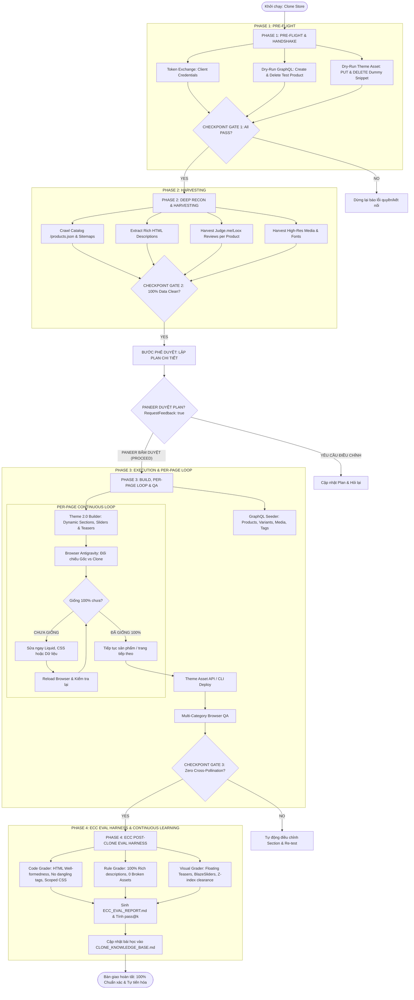

# Clone Shopify Skill (Full-Fidelity Storefront & Catalog Cloner with ECC Eval-Harness)

## 1. Title & Purpose
- **Title**: Enterprise Full-Store & Catalog Cloner for Shopify 2.0 with ECC Eval-Harness Integration
- **Purpose**: Provides a battle-tested, autonomous 4-Phase pipeline with Checkpoint Gating, Human-in-the-Loop Plan Approval, **Per-Page Antigravity Browser Self-Correction Loop**, and **ECC Post-Clone Evaluation Harness** to clone any e-commerce storefront into a 1:1 Shopify Theme 2.0 structure. Guarantees:
  1. **Pre-flight Connectivity (Phase 1)**: Verifies Shopify Client Credentials, GraphQL write permissions, and Theme Asset API.
  2. **Multi-Product Harvesting (Phase 2)**: Extracts 100% unique product descriptions, multi-tier collection metadata, high-res unscaled images (1600px+), and product-specific customer reviews.
  3. **Plan Approval Gate (Bridge Step)**: Generates a detailed implementation plan artifact (`execution_plan.md` with `RequestFeedback: true`) and pauses for user approval before modifying the theme.
  4. **Per-Page Browser Verification (Phase 3)**: Uses Antigravity IDE browser (`chrome-devtools`) to inspect each product, collection, floating teaser, and interactive slider side-by-side with the source. Iteratively fixes and re-verifies until achieving 100% visual and functional match.
  5. **Zero Cross-Pollination**: Dynamic Liquid conditions prevent content leaking across categories.
  6. **ECC Post-Clone Eval Harness (Phase 4)**: Runs deterministic AST syntax linting, HTML well-formedness checks (forbids `</div><div` corrupt sequences), CSS scope verification, DOM parity checks, generates `ECC_EVAL_REPORT.md` with `pass@k` / `pass^k` metrics, and updates `CLONE_KNOWLEDGE_BASE.md` so the agent continuously improves its first-attempt accuracy.

---

## 2. The 4-Phase Architecture & Self-Optimization Workflow



---

## 3. Automation Scripts & Executable Commands

### 🟢 GIAI ĐOẠN 1: Kiểm tra kết nối & quyền hạn (Pre-flight Handshake)
```bash
node h:/Shopify-Clone/.agents/skills/clone-shopify/scripts/verify-connection.mjs
```
* **Tiêu chí ĐẠT:** Token, GraphQL Product Create/Delete, Theme Asset API đều in ra `✔ PASS`.

---

### 🟡 GIAI ĐOẠN 2: Bóc tách danh mục, collections, mô tả & reviews (Deep Harvesting)
```bash
node h:/Shopify-Clone/.agents/skills/clone-shopify/scripts/crawl-catalog-and-reviews.mjs "[URL_GỐC]" "./data"
```
* **Nhiệm vụ thu hoạch:**
  1. Catalog & Phân loại danh mục.
  2. Collections Reconnaissance (Banner desktop/mobile picture tag, cấu trúc multi-tier, cờ `has_countdown`).
  3. Mô tả Rich HTML 100% không rỗng (bóc tách từ custom theme section nếu cần).
  4. Reviews độc lập từ Judge.me/Loox/Yotpo.
* **Output:** `data/catalog_harvested.json`, `data/collections_harvested.json`, `data/reviews_harvested.json`.

---

### 📋 BƯỚC PHÊ DUYỆT KẾ HOẠCH (MANDATORY PLAN APPROVAL GATE)
Agent xuất bản `execution_plan.md` với `RequestFeedback: true` và `UserFacing: true`.
**CHỜ PANEER BẤM DUYỆT (PROCEED)** trước khi thực hiện Giai đoạn 3.

---

### 🔴 GIAI ĐOẠN 3: Triển khai Theme, Đồng bộ Collections, Kiểm tra từng trang & QA
1. **Seeding Catalog & Collection qua GraphQL:**
   - Dùng script `.mjs` độc lập (tránh lỗi PowerShell `-e` với biến `$var`).
   - Thiết lập `sortOrder: MANUAL` trước khi reorder sản phẩm.
2. **Vòng lặp Kiểm tra & Tự sửa lỗi từng trang trên Browser Antigravity:**
   - PDP: Gallery, Color swatches, BOGO bundle pricing, Dynamic Save badge, Commit icons, Tabs nội dung, Customer reviews.
   - Collection: Banner desktop/mobile, Countdown bar điều kiện, Multi-tier layout.
   - Overlays & Sliders: Teaser ribbon góc 120x120 có `z-index: 99999` (không bị thanh Shopify preview bar che), BlazeSlider 5-card before/after trượt mượt mà.
   - **Chỉ làm trang tiếp theo khi trang hiện tại đã đạt 100%.**
3. **Thẩm định đa danh mục tổng thể:**
   ```bash
   node h:/Shopify-Clone/.agents/skills/clone-shopify/scripts/multi-product-qa.mjs
   ```

---

### 🧪 GIAI ĐOẠN 4: ECC Post-Clone Evaluation Harness & Nâng cấp Năng lực
Chạy mỗi khi paneer thông báo "dự án đã hoàn thành", "clone 1 theme hoàn thiện" hoặc trước khi nghiệm thu:
```bash
node h:/Shopify-Clone/.agents/skills/clone-shopify/scripts/post-clone-eval.mjs [PATH_THEME] [URL_GỐC]
```
* **Nhiệm vụ:**
  1. **Code-Based Grader:** Quét AST / Regex tìm cú pháp HTML hỏng (`</div><div`, `<div<`, duplicate attributes), lỗi nested Liquid filter trong `append:`, kiểm tra scoped CSS `#SectionId-` để ngăn chặn lỗi flex chồng chéo ảnh lên chữ.
  2. **Rule-Based Grader:** Đảm bảo 100% mô tả phong phú, kho assets đầy đủ, ma trận reviews cô lập.
  3. **Visual & Interactive Grader:** Kiểm tra z-index và toạ độ của floating teaser, cấu trúc slider tương tác.
  4. **Tự động tiến hóa:** Xuất bản `ECC_EVAL_REPORT.md` (chỉ số `pass@1`, `pass^3`) và ghi nhật ký kinh nghiệm vào `CLONE_KNOWLEDGE_BASE.md`.

---

## 4. Master Verification Matrix (ECC Standards)

| Hạng mục | Tiêu chuẩn ĐẠT | Phương thức Thẩm định |
| :--- | :--- | :--- |
| **Shopify Permissions** | Token, GraphQL Write, Theme Asset API đều PASS | `node scripts/verify-connection.mjs` |
| **Catalog Independence** | 100% sản phẩm có mô tả độc lập, ảnh so sánh, bảng size riêng | Quét `data/catalog_harvested.json` |
| **Plan Approval** | Paneer đã xem và bấm nút Proceed trên `execution_plan.md` | Human Checkpoint |
| **HTML Syntax Integrity** | 0 thẻ unclosed, 0 chuỗi `</div><div` hỏng, 0 lỗi AST | `node scripts/post-clone-eval.mjs` (Code Grader) |
| **CSS Scope Isolation** | Mọi section custom có `#SectionId-`, 0 lỗi ảnh đè lên chữ | `node scripts/post-clone-eval.mjs` (Code Grader) |
| **Floating Overlays** | Teaser góc 120x120 có `z-index: 99999`, không bị preview bar che | Chrome DevTools Inspection & Visual Grader |
| **Interactive Sliders** | BlazeSlider 5-card Before/After trượt mượt mà 1:1 | Browser Inspection & Visual Grader |
| **Collection Parity** | Đầy đủ banner, countdown bar theo điều kiện, multi-tier layout | Browser Side-by-Side Loop |
| **Cross-Pollination** | Giày búp bê/Sandal không chứa ảnh hoặc review về bốt tuyết | `node scripts/multi-product-qa.mjs` |
| **Variant Switching** | Click swatch màu đổi ảnh gallery ngay lập tức | Browser click test |
| **Bundle & Dynamic Badges** | Chọn bundle cập nhật giá chuẩn; badge SAVE tính đúng | Browser ATC & Badge test |
| **Continuous Learning** | Báo cáo `ECC_EVAL_REPORT.md` sinh đầy đủ, cập nhật KB | `node scripts/post-clone-eval.mjs` (Auto-KB Hook) |
