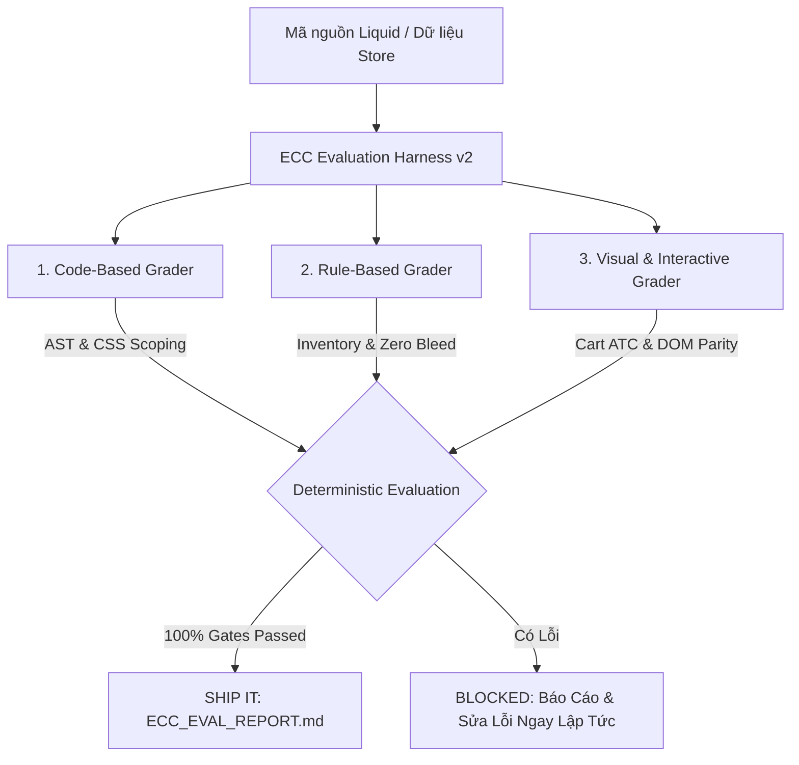

# 🛍️ Zavelyn Multi-Funnel Storefront Engineering & ECC Evaluation Harness

> **Enterprise Shopify 2.0 Multi-Funnel Storefront**: 1:1 High-Conversion Clone, Zero-Bleed Isolation Architecture, and Deterministic Enterprise Clone Compliance (ECC) Suite.

[](https://shopify.dev/docs/themes)
[-success.svg)](./ECC_EVAL_REPORT.md)
[](https://tryzavelyn.com)
[](./ECC_EVAL_REPORT.md)

---

## 📌 1. Bối cảnh & Mục tiêu Dự án (Project Overview)

Repository này chứa toàn bộ mã nguồn, cấu hình theme, dữ liệu sản phẩm, và các kịch bản tự động hóa Node.js để quản lý và vận hành cửa hàng Shopify **Zavelyn** (`dsdujr-vn.myshopify.com` / `https://tryzavelyn.com`).

Hệ thống được thiết kế theo mô hình **Multi-Funnel Isolation (Cách ly đa phễu)** trên nền tảng Shopify 2.0:
- Cho phép nhiều dòng sản phẩm Direct-Response (DR) và E-commerce độc lập (vFit Wellness, BotanaRoots Hair Oil, Handpans 432Hz, Sakerplus, Yeoman, Thoson MagTrack, Srefalsteam) cùng vận hành trên một cửa hàng duy nhất.
- **Triệt để loại trừ lây nhiễm chéo nội dung (Zero Cross-Pollination / Zero Bleed)**: Mỗi phễu sở hữu template, section, CSS scope và logic upsell riêng biệt mà không làm ảnh hưởng đến các sản phẩm khác.
- **Chuẩn hóa quy trình kiểm thử với ECC Harness**: Áp dụng bộ 3 Grader (Code Grader, Rule Grader, Visual Grader) để đánh giá tính toàn vẹn trước và sau mỗi đợt deploy.

---

## 🌐 2. Bản đồ Theme & Môi trường Thực thi (Theme Landscape)

| Theme ID | Tên Theme trên Store | Vai trò (Role) | Trạng thái & Mô tả |
| :--- | :--- | :---: | :--- |
| **`187597717689`** | **Zavelyn 2.0** | `main` | **THEME LIVE CHÍNH THỨC**. Đang phục vụ toàn bộ khách hàng trên `https://tryzavelyn.com`. Chứa đầy đủ bản cập nhật mới nhất của vFit, BotanaRoots, Handpans và các phễu DR. |
| **`187720335545`** | **[Draft] Zavelyn - Fix Non-Botana Products Isolation** | `unpublished` | **THEME DRAFT KIỂM THỬ**. Dùng làm staging môi trường cách ly, chạy nghiệm thu các tính năng mới trước khi deploy lên live theme. |
| **`186607567033`** | **Zavelyn (Pre-Publish Backup)** | `unpublished` | **THEME DỰ PHÒNG AN TOÀN**. Bản sao lưu đầy đủ 915 file trước đợt nâng cấp Zavelyn 2.0. |

- **Shopify Store URL**: `https://dsdujr-vn.myshopify.com`
- **Tên miền Public**: `https://tryzavelyn.com`
- **Shopify API Version**: `2024-10` / `2026-10` (GraphQL & Admin REST API)

---

## 🎯 3. Kiến trúc Các Phễu Trọng Yếu (Core Product Funnels)

### 1. Phễu Hero: Zavelyn vFit™ Red Light Intimate Wellness Device
* **URL:** `https://tryzavelyn.com/products/zavelyn-vfit-red-light-intimate-wellness-device`
* **Template Liquid:** `templates/product.zavelyn.json` ➔ `sections/zavelyn-pdp-main.liquid` & `snippets/vfit-selfcare-upsell.liquid`.
* **Đặc tính kỹ thuật & Logic mới nhất:**
  - **Multi-Quantity Pricing Engine**:
    - Bộ chọn số lượng (Quantity Selector: 1 pc, 2 pcs, 3 pcs) tại Main Hero với chiết khấu lũy tiến.
    - Giá vFit chuẩn $149.99 theo dữ liệu store.
  - **Modular Self-Care Upsells Engine** (`snippets/vfit-selfcare-upsell.liquid`):
    - Hai sản phẩm add-on tùy chọn: **Red Light Eye Care Mask** ($39.99) và **LED Red Light Face Mask** ($49.99).
    - Tích hợp **bộ đếm số lượng độc lập** (`.zv-card-qty-stepper`, `.zv-card-qty-btn`, `.zv-card-qty-num`) cho từng add-on, cho phép khách hàng chọn mua 2, 3... sản phẩm upsell ngay trong cùng 1 đơn.
    - Checkbox kích hoạt linh hoạt, hỗ trợ cả 2 phiên bản giao diện (Version A 2-cột và Version B modal).
  - **Dynamic Order Summary**: Tự động tính toán tổng giá trị đơn hàng theo thời gian thực (Base vFit + Add-on 1 × Qty + Add-on 2 × Qty).
  - **Nút "Claim Offer" & "Buy Now (1-Click Checkout)"**:
    - Nút Claim Offer (`#zvClaimOfferBtn`, `.kc-claim-button`) gộp toàn bộ sản phẩm đã chọn thành một payload nguyên tử gửi trực tiếp tới `/cart/add.js`.
    - Nút 1-Click Checkout (`#zvBuyNowBtn`, `.zv-buy-now-btn`) chuyển thẳng tới luồng Shopify Checkout bảo mật.
  - **Official Shopify Vector Payment Icons**:
    - Đã thay thế toàn bộ SVG cũ bị méo hình bằng thẻ chính thức của Shopify: `payment_type_svg_tag: class: 'zv-pay-svg'`.
    - Hiển thị sắc nét 100% trên cả Retina Display và màn hình mobile cho: Visa, Mastercard, American Express, Apple Pay, Google Pay, Shop Pay, Discover.
  - **Official Branded Box Packaging Image**:
    - Ảnh minh họa cơ chế hoạt động tại mục *"How the Zavelyn vFit™ Triple Action Works"* được cập nhật sang ảnh hộp chính hãng có in logo **ZAVELYN**:
      `https://cdn.shopify.com/s/files/1/0826/2483/9865/files/joylux_triple_tech.png?v=1793206025`
  - **9-Part Medical & Consumer Trials FAQ Accordion**:
    - Bổ sung khối câu hỏi thường gặp gồm 9 câu hỏi y khoa & thử nghiệm lâm sàng ngay dưới phần *"Real Reviews from Over 100,000+ Women"*.
    - Sử dụng thẻ HTML5 semantic `<details class="zv-vfit-faq-item">` kết hợp animation mở mượt mà (`.zv-vfit-faq-item[open]`).

---

### 2. Phễu Hero: BotanaRoots Organic Batana Hair Growth Oil
* **URL:** `https://tryzavelyn.com/products/zavelyn-botanaroots-organic-batana-hair-growth-oil`
* **Template Liquid:** `templates/product.json` ➔ `snippets/botanaroots-bundle-upsell.liquid` & `snippets/botanaroots-faq-accordion.liquid`.
* **Zero-Bleed Isolation Architecture:**
  - Được bảo vệ nghiêm ngặt bằng điều kiện kiểm tra handle ``.
  - Không bao giờ kế thừa hoặc bị ảnh hưởng bởi styles, scripts, bundles hoặc markup của vFit và các sản phẩm khác (đạt tỷ lệ 0 bleed / 100% isolation).

---

### 3. Phễu Danh mục: Zavelyn Handpans & Sound Therapy Drums
* **URL:** `https://tryzavelyn.com/collections/zavelyn-handpans`
* **Sản phẩm chủ lực:** Handpan Master 14-inch, Rain Drum, Drum Plus, Drum Mini.
* **Tính năng:** Tích hợp bộ nghe thử âm thanh tần số 432Hz, starter kit 7 món, và bảng so sánh quy cách sản phẩm.

---

### 4. Các Phễu Direct-Response Khác
- **Sakerplus**: 5-in-1 Rotary Cheese Grater & Shredder, Livestock Heating Lamp (`sections/heating-lamp-funnel.liquid`), Portable Camping Fan.
- **Yeoman**: Leaf Sweep Funnel (`sections/yeoman-sweep-funnel.liquid`).
- **Thoson**: MagTrack Funnel (`sections/thoson-magtrack-funnel.liquid`).
- **Srefalsteam**: Steamer Funnel (`sections/srefalsteam-funnel.liquid`).
- **Nroome**: 2.0 Portable Ultrasonic Mesh Nebulizer.
- **CozyHeat**: USB Heated Wearable Blanket Sweater.

---

## 🧪 4. Bộ Tiêu Chuẩn ECC (Enterprise Clone Compliance Framework)

Mọi thay đổi trên theme hoặc sản phẩm đều phải vượt qua bộ 3 Grader của ECC trước khi nghiệm thu:



### Bộ 3 Graders của ECC:
1. **Code-Based Grader (AST & Liquid Syntax Integrity)**:
   - Cấm hoàn toàn chuỗi thẻ hỏng `</div><div`, `<div<div`, hoặc trùng lặp attribute.
   - Kiểm tra an toàn Liquid filter (không lồng filter trong `append:`).
   - Xác thực cú pháp JSON template và kiểm tra toàn bộ section được tham chiếu đều tồn tại.
   - Kiểm tra cách ly CSS: toàn bộ CSS tùy biến phải được namespace bằng `.zv-`, `.willa-`, hoặc `#SectionId-{{ section.id }}`.
2. **Rule-Based Grader (Catalog, Inventory Policy, Isolation & Media)**:
   - **Quy tắc tồn kho**: 100% variants trên toàn bộ catalog (85 sản phẩm) phải kích hoạt `inventory_policy = 'continue'` để không bao giờ đứt gãy đơn hàng.
   - **Zero Cross-Pollination**: Kiểm tra cách ly tuyệt đối cho BotanaRoots và các phễu độc lập.
   - **Official Payment Badges**: Sử dụng vector SVG chính thống từ Shopify thay vì ảnh tĩnh.
   - **Rich Descriptions & Native CDN**: Mô tả advertorial đầy đủ và ưu tiên lưu trữ media trên Shopify CDN (`cdn.shopify.com`).
3. **Visual & Interactive Grader (Functional Parity & UX)**:
   - Kiểm tra tương tác bộ chọn số lượng (Main + Add-ons).
   - Kiểm tra sự kiện Claim Offer kết nối chính xác với API `/cart/add.js`.
   - Kiểm tra tính toán tổng tiền Dynamic Order Summary.
   - Kiểm tra z-index các phần tử nổi (tránh bị che bởi thanh quản trị Shopify Preview Bar).

---

## 📂 5. Cấu Trúc Thư Mục Dự Án (Directory Layout)

```
c:\Users\Admin\Desktop\CLONE SPF/
├── .agents/skills/              # Kiến thức chuyên sâu và hướng dẫn thao tác AI
│   └── clone-shopify/
│       ├── SKILL.md             # Bộ quy chuẩn 4 giai đoạn và ma trận kiểm thử ECC
│       └── CLONE_KNOWLEDGE_BASE.md # Nhật ký kinh nghiệm & tự động tối ưu hóa
├── assets/                      # CSS, JS, Fonts và WebP graphics của theme
├── sections/                    # Các section Liquid tùy biến (zavelyn-pdp-main, willa-*, thoson-*, etc.)
├── snippets/                    # Các snippet tái sử dụng (vfit-selfcare-upsell, botanaroots-*, etc.)
├── templates/                   # JSON templates của Shopify 2.0 (product.zavelyn.json, etc.)
├── scripts/                     # Hơn 500 script Node.js phục vụ trích xuất, build, deploy & audit
│   ├── ecc_eval_zavelyn_v2.mjs  # Bộ kiểm thử ECC Evaluation Harness mới nhất
│   ├── batch1_config.mjs        # Cấu hình xác thực Shopify OAuth và biến API
│   ├── verify_vfit_new_image_live.mjs # Script kiểm tra CDP ảnh hộp Zavelyn vFit
│   ├── verify_vfit_faq_live.mjs # Script kiểm tra CDP accordion FAQ
│   ├── verify_payment_icons_live.mjs # Script kiểm tra hiển thị payment SVG
│   └── step4_strict_botanaroots_zero_change_audit.mjs # Script kiểm toán zero-bleed BotanaRoots
├── ECC_EVAL_REPORT.md           # Báo cáo đánh giá chất lượng chuẩn ECC tự động sinh
├── list_themes.mjs              # Liệt kê danh sách theme và trạng thái trên store
├── scripts_ecc_eval_zavelyn.mjs # Proxy chạy ECC evaluation v2 từ root
└── README.md                    # Tài liệu kiến trúc và hướng dẫn vận hành tổng thể
```

---

## ⚡ 6. Hướng Dẫn Vận Hành & Lệnh Thao Tác (Operational Runbook)

### 1. Kiểm tra danh sách theme trên store
Lấy danh sách theme, ID và role hiện tại từ Shopify Admin API:
```bash
node list_themes.mjs
```

### 2. Thực thi bộ kiểm thử ECC Harness v2
Chạy kiểm tra toàn diện Code Grader, Rule Grader và Visual Grader trên cả Live Theme và Catalog:
```bash
node scripts/ecc_eval_zavelyn_v2.mjs
# hoặc chạy nhanh từ file root:
node scripts_ecc_eval_zavelyn.mjs
```
Kết quả sẽ tự động được ghi đè vào file [ECC_EVAL_REPORT.md](file:///c:/Users/Admin/Desktop/CLONE%20SPF/ECC_EVAL_REPORT.md) và ghi nhận vào [CLONE_KNOWLEDGE_BASE.md](file:///c:/Users/Admin/Desktop/CLONE%20SPF/.agents/skills/clone-shopify/CLONE_KNOWLEDGE_BASE.md).

### 3. Kiểm tra tính năng vFit mới cập nhật qua Chrome CDP
Chụp ảnh và thẩm định trực quan các khối vừa nâng cấp trên live storefront:
```bash
# Kiểm tra ảnh hộp ZAVELYN Triple Action trên trang live
node scripts/verify_vfit_new_image_live.mjs

# Kiểm tra FAQ accordion 9 câu hỏi dưới review
node scripts/verify_vfit_faq_live.mjs

# Kiểm tra bộ icon thanh toán chính hãng
node scripts/verify_payment_icons_live.mjs
```

### 4. Kiểm toán chống lây nhiễm chéo (Zero Bleed Audit)
Kiểm tra đảm bảo phễu BotanaRoots không nhận bất kỳ thay đổi nào từ vFit:
```bash
node scripts/step4_strict_botanaroots_zero_change_audit.mjs
```

### 5. Sao lưu và khôi phục khẩn cấp
- Bản sao lưu live theme được lưu trong `backups/` và `draft_theme_backup/`.
- File manifest theo dõi: `scripts/pre_publish_backups_manifest.json`.

---

## 📝 7. Lịch Sử Nâng Cấp Gần Nhất (Recent Changelog)

### Phiên bản 2.4 (Cập nhật mới nhất):
- **Official Payment Badges**: Nâng cấp toàn bộ icon thanh toán từ vector mờ/méo sang thẻ Shopify `payment_type_svg_tag: class: 'zv-pay-svg'`.
- **vFit Interactive FAQ Accordion**: Thêm 9 câu hỏi thường gặp về y khoa và thử nghiệm người dùng đặt ngay dưới khối *"Real Reviews from Over 100,000+ Women"*.
- **Branded Box Packaging Media**: Thay thế ảnh giải thích công nghệ Triple Action sang ảnh hộp chính thức có logo "ZAVELYN" (`joylux_triple_tech.png?v=1793206025`).
- **Multi-Quantity Selectors**: Hỗ trợ tăng giảm số lượng linh hoạt cho cả máy chính vFit và 2 sản phẩm add-on upsell (Eye Mask & Face Mask).
- **ECC Evaluation Harness v2**: Nâng cấp công cụ đánh giá tự động với tỷ lệ vượt qua đạt **100% (SHIP IT READY)**.

---

*Tài liệu được bảo trì tự động bởi Antigravity AI Cloner và chuẩn hóa theo bộ quy tắc Enterprise Clone Compliance (ECC).*
