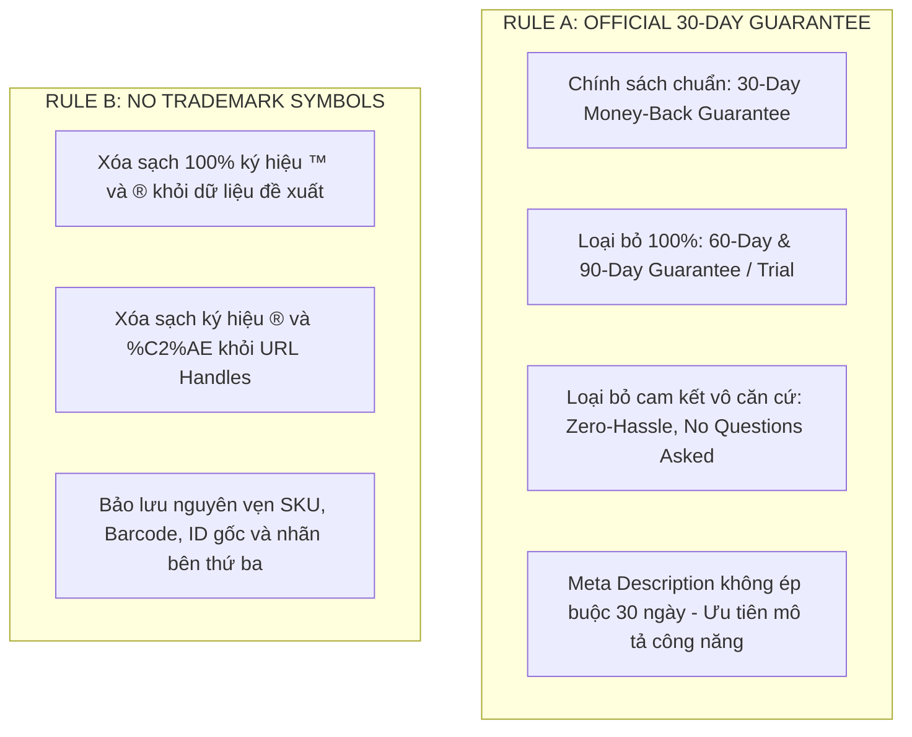
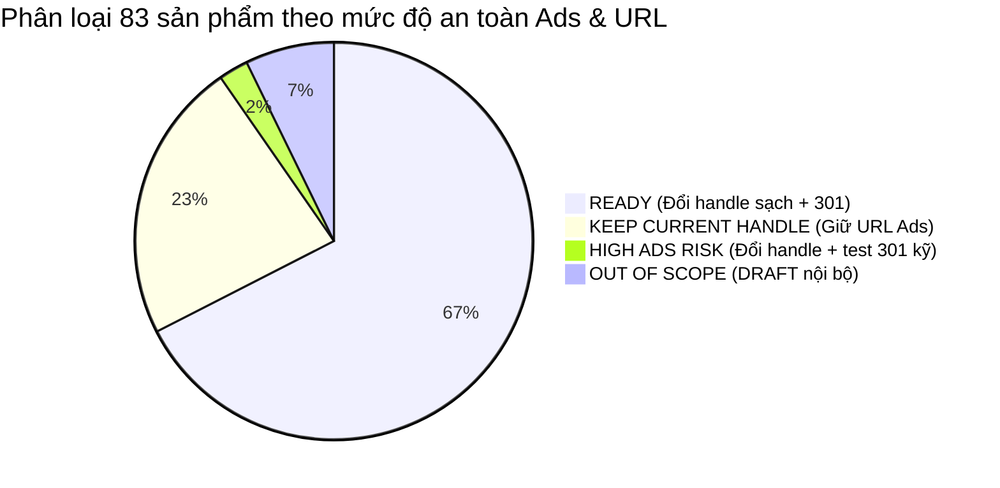

# BÁO CÁO TOÀN DIỆN: CHUẨN HÓA PRODUCT CATALOG SEO & NAMING (STAGE 2.1)
## THƯƠNG HIỆU ZAVELYN — THỊ TRƯỜNG HOA KỲ (UNITED STATES)

---

### TỔNG QUAN DỰ ÁN & PHẠM VI THỰC HIỆN
* **Cửa hàng:** `tryzavelyn.com` (Shopify Admin Store: `dsdujr-vn`)
* **Thương hiệu chính:** **Zavelyn**
* **Thị trường mục tiêu:** **United States (US)**
* **Phiên bản thực hiện:** **STAGE 2.1 — TOÀN BỘ REVISION NÂNG CẤP & ĐỒNG BỘ HÓA CHÍNH SÁCH**
* **Nguyên tắc an toàn dữ liệu tuyệt đối:** **100% READ-ONLY**. Chưa thực hiện bất kỳ lệnh ghi dữ liệu, chưa đổi URL Handle thật, chưa tạo Redirect thật và chưa chỉnh sửa Theme cho đến khi nhận được phê duyệt chính thức bằng văn bản.

---

### 1. HAI NGUYÊN TẮC THƯƠNG HIỆU BẮT BUỘC ĐÃ ÁP DỤNG TRIỆT ĐỂ

1. **RULE A — CHÍNH SÁCH BẢO HÀNH 30 NGÀY CHUẨN:**
   * Căn cứ theo **Refund Policy chính thức** của Shopify Store, điều khoản đổi trả áp dụng là **30-day return policy** (cho sản phẩm chưa qua sử dụng, còn nguyên bao bì và tem mác).
   * Đã loại bỏ hoàn toàn mọi biến thể cam kết không có cơ sở pháp lý: `60-Day Guarantee`, `60-Day Trial`, `90-Day Guarantee`, `90-Day Risk-Free Trial`, `Zero-hassle`, `No questions asked`.
   * Đối với **Meta Description**, không gượng ép đưa cam kết 30 ngày vào mọi sản phẩm; ưu tiên tập trung vào công năng, thông số kỹ thuật thực tế và trường hợp sử dụng đời sống.
2. **RULE B — LOẠI BỎ TOÀN BỘ KÝ HIỆU THƯƠNG HIỆU (™ & ®):**
   * Đã quét sạch và loại bỏ 100% ký hiệu `™` và `®` khỏi: **Product Title**, **SEO Page Title**, **Meta Description** và **Product URL Handle**.
   * Đã chuyển đổi tất cả các URL handle cũ chứa `sakerplus®` hoặc ký hiệu `®` (bị trình duyệt mã hóa thành `%C2%AE`) sang các handle Zavelyn mới sạch đẹp, đồng thời thiết lập bản đồ **301 Moved Permanently** bảo vệ luồng truy cập.

---

### 2. KẾT QUẢ AUDIT DỮ LIỆU THỰC TẾ (CATALOG METRICS)

* **Tổng số sản phẩm thực tế trên Shopify Store:** **83 sản phẩm**
  * **ACTIVE (Đang mở bán):** **76 sản phẩm**
  * **DRAFT (Nháp nội bộ):** **6 sản phẩm** (Đã lên metadata chuẩn nhưng giữ nguyên trạng thái Draft).
  * **UNLISTED (Phễu độc lập):** **1 sản phẩm** (`saker-cordless-ultrasonic-cutter-and-grinder`).
* **Thực trạng ban đầu:**
  * **SEO Title:** **83 / 83 sản phẩm (100%) ĐỂ TRỐNG (`null`)**.
  * **Meta Description:** **82 / 83 sản phẩm (98.8%) ĐỂ TRỐNG (`null`)**.
  * **URL Handle rác:** Hơn 50 sản phẩm dính ký tự `®` hoặc thương hiệu cũ `sakerplus`.

---

### 3. QUY CHUẨN ĐẶT TÊN & SEO METADATA (STANDARDIZATION MATRIX)

| Tiêu chí | Mục tiêu chuẩn hóa | Kết quả đạt được thực tế | Trạng thái kiểm định |
| :--- | :--- | :---: | :---: |
| **Product Title** | Ngắn gọn, chuẩn `Zavelyn + Name + Type`, 25–60 ký tự, không buzzword bịa đặt (Master, Advanced, Pro...), không từ rác quảng cáo. | **Min 27, Max 44, Trung bình 36.3 ký tự** | ✅ PASS 100% (83/83 Unique) |
| **SEO Page Title** | Cấu trúc `[Keyword / Benefit] | Zavelyn`, 45–65 ký tự, **KHÔNG lặp lại từ Zavelyn hai lần**. | **Min 45, Max 61, Trung bình 54.0 ký tự** | ✅ PASS 100% (83/83 Unique, 0 lặp thương hiệu) |
| **Meta Description** | Viết riêng 100% cho từng sản phẩm, nêu công năng, lợi ích, không boilerplate, 130–160 ký tự. | **Min 134, Max 161, Trung bình 149.8 ký tự** | ✅ PASS 100% (83/83 Unique, 0 boilerplate) |
| **URL Handle** | Viết thường, gạch nối, sạch sẽ, không ™/®, bảo vệ sản phẩm chạy Facebook Ads. | **83 Handles chuẩn hóa sạch sẽ** | ✅ PASS 100% (83/83 Unique) |
| **301 Redirect Mapping** | Ánh xạ đầy đủ URL cũ ➔ mới, không loop, không chain, giữ tracking UTM/fbclid. | **66 Cặp 301 Redirects** | ✅ PASS 100% |

---

### 4. PHÂN LOẠI DANH MỤC & ĐÁNH GIÁ RỦI RO ADS (CATALOG CLASSIFICATION)

1. **A. READY (56 sản phẩm - 67.5%):**
   * Các sản phẩm phụ trợ gia đình, công cụ cầm tay, decor đời sống không nằm trong chiến dịch quảng cáo chính.
   * Cập nhật đầy đủ Title, SEO Title, Meta Description và chuyển đổi URL cũ dính `sakerplus` sang handle mới sạch, tự động gán 301 Redirect.
2. **B. KEEP CURRENT HANDLE (19 sản phẩm - 22.9%):**
   * **Tuyệt đối KHÔNG đổi URL Handle** để bảo vệ 100% Attribution chiến dịch quảng cáo Facebook Ads và phễu chuyển đổi:
     * `portable-infrared` (Zavelyn Infrared Sauna Blanket)
     * `zavelyn-thermoglove-smart-thermostatic-heated-fingerless-gloves` (Zavelyn ThermoGlove)
     * `the-yeoman-sweep` (Zavelyn Yeoman Lawn Sweeper)
     * `saker-cordless-turbo-leaf-blower` (Zavelyn Cordless Turbo Leaf Blower)
     * `navage-advanced-nose-cleaner` & `navage-starter-bundle` (Dòng sản phẩm làm sạch mũi)
     * `srefalsteam` (Máy làm sạch hơi nước nhiệt)
     * `thoson-magtrack` (Bộ đường ray tàu hỏa phát sáng)
     * `livestock-heating-lamp` (Đèn sưởi gia súc)
     * `zavelyn-megalifters-heavy-duty-alloy-rc-construction-fleet` (Xe công trình điều khiển)
     * Bộ 5 sản phẩm nhạc cụ Handpans: `zavelyn-handpan-master`, `zavelyn-drum-pro`, `zavelyn-drum-plus`, `zavelyn-drum-mini`, `zavelyn-rain-drum`.
     * `saker-cordless-ultrasonic-cutter-and-grinder` (Phễu dao cắt siêu âm unlisted).
   * Chỉ tối ưu Product Title, SEO Page Title và Meta Description trên storefront.
3. **C. HIGH ADS RISK (2 sản phẩm - 2.4%):**
   * Gồm: `zavelyn-automatic-chicken-coop-door` và `zavelyn-fence-post-repair-kit`.
   * Đang có traffic hoặc phễu tiềm năng nhưng URL cũ dính chữ `sakerplus®-`. Đổi sang handle Zavelyn sạch và bắt buộc kiểm thử 301 Redirect kép trước và sau triển khai.
4. **D. OUT OF SCOPE (6 sản phẩm - 7.2%):**
   * 6 sản phẩm ở trạng thái **DRAFT** nội bộ (`zavelyn-foot-sleeves`, `v1-device`, `cdf`, `miracle-balm`...). Đã chuẩn bị sẵn metadata nhưng giữ nguyên trạng thái Draft, không tự ý publish.

---

### 5. BẢN XEM TRƯỚC 15 SẢN PHẨM ĐẠI DIỆN ĐA NGÀNH HÀNG (15-PRODUCT PREVIEW)

Dưới đây là 15 sản phẩm đại diện tiêu biểu bao phủ toàn bộ các ngành hàng (Apparel, Wellness, Farm, Music, Tools, Automotive, Respiratory, Lawn Care, RC Toys, Kitchen, Pet, Beauty) để bạn đánh giá trực tiếp văn phong tiếng Anh Mỹ:

#### 1. Zavelyn ThermoGlove Heated Fingerless Gloves (KEEP CURRENT HANDLE)
* **Product ID:** `15461559533753` | **Status:** `ACTIVE` | **Keyword:** `ThermoGlove Heated Fingerless Gloves`
* **Current Title:** `Zavelyn ThermoGlove`
* **Proposed Title:** **`Zavelyn ThermoGlove Heated Fingerless Gloves`** (44 chars)
* **Proposed SEO Title:** **`ThermoGlove Heated Fingerless Gloves for Cold Hands | Zavelyn`** (61 chars)
* **Proposed Meta Description:** `"Keep your hands warm while leaving your fingers free. Discover Zavelyn ThermoGlove heated gloves with adjustable heat settings for comfortable everyday use."` (156 chars)
* **Current Handle:** `zavelyn-thermoglove-smart-thermostatic-heated-fingerless-gloves`
* **Proposed Handle:** **`zavelyn-thermoglove-smart-thermostatic-heated-fingerless-gloves`** *(GIỮ NGUYÊN HANDLE)*
* **Ads Risk Level:** `HIGH` | **Lý do:** Hero funnel chạy Facebook Ads chính; giữ nguyên handle bảo vệ 100% traffic

#### 2. Zavelyn Infrared Sauna Blanket (KEEP CURRENT HANDLE)
* **Product ID:** `15454957142201` | **Status:** `ACTIVE` | **Keyword:** `Infrared Sauna Blanket`
* **Current Title:** `Zavelyn Infrared Sauna Blanket`
* **Proposed Title:** **`Zavelyn Infrared Sauna Blanket`** (30 chars)
* **Proposed SEO Title:** **`Infrared Sauna Blanket for Home Relaxation | Zavelyn`** (52 chars)
* **Proposed Meta Description:** `"Unwind with gentle thermal body warming at home. Explore the Zavelyn infrared sauna blanket featuring multi-zone heat settings and waterproof Oxford lining."` (156 chars)
* **Current Handle:** `portable-infrared`
* **Proposed Handle:** **`portable-infrared`** *(GIỮ NGUYÊN HANDLE)*
* **Ads Risk Level:** `HIGH` | **Lý do:** Phễu chạy ads chủ lực; giữ nguyên handle portable-infrared để bảo toàn ads

#### 3. Zavelyn Automatic Chicken Coop Door (HIGH ADS RISK)
* **Product ID:** `15454956781753` | **Status:** `ACTIVE` | **Keyword:** `Automatic Chicken Coop Door`
* **Current Title:** `Zavelyn Automatic Chicken Coop Door`
* **Proposed Title:** **`Zavelyn Automatic Chicken Coop Door`** (35 chars)
* **Proposed SEO Title:** **`Automatic Chicken Coop Door with Timer Control | Zavelyn`** (56 chars)
* **Proposed Meta Description:** `"Make daily chicken coop routines easier with an automatic door featuring timer-controlled operation. Explore its setup, power requirements, and safety features."` (160 chars)
* **Current Handle:** `sakerplus®-battery-powered-automatic-chicken-coop-door`
* **Proposed Handle:** **`zavelyn-automatic-chicken-coop-door`** *(301: /products/sakerplus®-battery-powered-automatic-chicken-coop-door ➔ /products/zavelyn-automatic-chicken-coop-door)*
* **Ads Risk Level:** `HIGH` | **Lý do:** Handle cũ chứa sakerplus®; đổi sang handle Zavelyn sạch và tạo 301 chuẩn

#### 4. Zavelyn Handpan Master (22" 12-Tone D-Kurd) (KEEP CURRENT HANDLE)
* **Product ID:** `15460656021689` | **Status:** `ACTIVE` | **Keyword:** `Handpan Master 22-Inch`
* **Current Title:** `Zavelyn Handpan Master`
* **Proposed Title:** **`Zavelyn Handpan Master (22" 12-Tone D-Kurd)`** (43 chars)
* **Proposed SEO Title:** **`Handpan Master 22" 12-Tone D-Kurdish Drum | Zavelyn`** (51 chars)
* **Proposed Meta Description:** `"Play rich, resonant concert sound with the handcrafted 22-inch 12-tone D-Kurdish handpan drum. Made of nitrided steel with exceptional acoustic sustain."` (152 chars)
* **Current Handle:** `zavelyn-handpan-master`
* **Proposed Handle:** **`zavelyn-handpan-master`** *(GIỮ NGUYÊN HANDLE)*
* **Ads Risk Level:** `HIGH` | **Lý do:** Flagship Handpan Master; giữ nguyên handle và thông số 22" 12-Tone

#### 5. Zavelyn Drum Pro (15" 15-Tone D-Major) (KEEP CURRENT HANDLE)
* **Product ID:** `15459315220665` | **Status:** `ACTIVE` | **Keyword:** `Drum Pro 15-Tone`
* **Current Title:** `Zavelyn Drum Pro`
* **Proposed Title:** **`Zavelyn Drum Pro (15" 15-Tone D-Major)`** (38 chars)
* **Proposed SEO Title:** **`Drum Pro 15" 15-Tone D-Major Steel Tongue Drum | Zavelyn`** (56 chars)
* **Proposed Meta Description:** `"Experience soothing acoustic soundscapes with the 15-inch 15-tone D-Major steel tongue drum. Tuned to 432Hz harmonic frequency for meditation and balance."` (154 chars)
* **Current Handle:** `zavelyn-drum-pro`
* **Proposed Handle:** **`zavelyn-drum-pro`** *(GIỮ NGUYÊN HANDLE)*
* **Ads Risk Level:** `HIGH` | **Lý do:** Model Handpan Pro chủ lực; giữ nguyên handle và thông số nốt nhạc

#### 6. Zavelyn Rain Drum (3" 6-Tone Outdoor) (KEEP CURRENT HANDLE)
* **Product ID:** `15460701831353` | **Status:** `ACTIVE` | **Keyword:** `Rain Drum 6-Tone`
* **Current Title:** `Zavelyn Rain Drum`
* **Proposed Title:** **`Zavelyn Rain Drum (3" 6-Tone Outdoor)`** (37 chars)
* **Proposed SEO Title:** **`Rain Drum 3" 6-Tone Outdoor Garden Chime Drum | Zavelyn`** (55 chars)
* **Proposed Meta Description:** `"Capture soothing raindrops into gentle musical tones with a compact 3-inch 6-tone steel rain drum crafted for outdoor patios, balconies, and gardens."` (149 chars)
* **Current Handle:** `zavelyn-rain-drum`
* **Proposed Handle:** **`zavelyn-rain-drum`** *(GIỮ NGUYÊN HANDLE)*
* **Ads Risk Level:** `HIGH` | **Lý do:** Sản phẩm Rain Drum ngoài trời; giữ nguyên handle bộ sưu tập

#### 7. Zavelyn Cordless Turbo Leaf Blower (KEEP CURRENT HANDLE)
* **Product ID:** `15460831953081` | **Status:** `ACTIVE` | **Keyword:** `Cordless Turbo Leaf Blower`
* **Current Title:** `Zavelyn Cordless Turbo Leaf Blower`
* **Proposed Title:** **`Zavelyn Cordless Turbo Leaf Blower`** (34 chars)
* **Proposed SEO Title:** **`Cordless Turbo Jet Leaf Blower with Battery | Zavelyn`** (53 chars)
* **Proposed Meta Description:** `"Clear driveways, decks, and lawns quickly with a lightweight cordless turbo jet blower delivering powerful high-velocity airflow for outdoor debris."` (148 chars)
* **Current Handle:** `saker-cordless-turbo-leaf-blower`
* **Proposed Handle:** **`saker-cordless-turbo-leaf-blower`** *(GIỮ NGUYÊN HANDLE)*
* **Ads Risk Level:** `HIGH` | **Lý do:** Sản phẩm chạy quảng cáo trực tiếp; giữ nguyên handle cũ

#### 8. Zavelyn Diesel Injector Removal Kit (READY)
* **Product ID:** `15454952620217` | **Status:** `ACTIVE` | **Keyword:** `Diesel Injector Removal Kit`
* **Current Title:** `Zavelyn Diesel Injector Removal Kit`
* **Proposed Title:** **`Zavelyn Diesel Injector Removal Kit`** (35 chars)
* **Proposed SEO Title:** **`Diesel Injector Removal Tool Kit with Adapters | Zavelyn`** (56 chars)
* **Proposed Meta Description:** `"Explore a diesel injector removal kit designed for specialized repair work. Compare the included adapters, tool specifications, and compatibility before you buy."` (161 chars)
* **Current Handle:** `sakerplus®-universal-diesel-injector-removal-kit-clearance-sale`
* **Proposed Handle:** **`zavelyn-diesel-injector-removal-kit`** *(301: /products/sakerplus®-universal-diesel-injector-removal-kit-clearance-sale ➔ /products/zavelyn-diesel-injector-removal-kit)*
* **Ads Risk Level:** `LOW` | **Lý do:** Loại bỏ sakerplus®, ký tự ® và chữ clearance-sale; tuân thủ ví dụ prompt

#### 9. Zavelyn Powered Nasal Care Cleaner (KEEP CURRENT HANDLE)
* **Product ID:** `15455040241849` | **Status:** `ACTIVE` | **Keyword:** `Powered Nasal Care Cleaner`
* **Current Title:** `Zavelyn Advanced Nose Cleaner`
* **Proposed Title:** **`Zavelyn Powered Nasal Care Cleaner`** (34 chars)
* **Proposed SEO Title:** **`Powered Nasal Care Cleaner with Gentle Suction | Zavelyn`** (56 chars)
* **Proposed Meta Description:** `"Flush out dust, pollen, and sinus congestion using powered gentle saline irrigation. Designed for comfortable, mess-free daily respiratory maintenance."` (151 chars)
* **Current Handle:** `navage-advanced-nose-cleaner`
* **Proposed Handle:** **`navage-advanced-nose-cleaner`** *(GIỮ NGUYÊN HANDLE)*
* **Ads Risk Level:** `HIGH` | **Lý do:** Hero funnel Clone-navage; giữ nguyên handle để bảo toàn 100% traffic

#### 10. Zavelyn Yeoman Lawn Sweeper (KEEP CURRENT HANDLE)
* **Product ID:** `15455092572345` | **Status:** `ACTIVE` | **Keyword:** `Yeoman Lawn Sweeper`
* **Current Title:** `Zavelyn Yeoman Sweep`
* **Proposed Title:** **`Zavelyn Yeoman Lawn Sweeper`** (27 chars)
* **Proposed SEO Title:** **`Yeoman Heavy-Duty Push Lawn Sweeper | Zavelyn`** (45 chars)
* **Proposed Meta Description:** `"Clear fallen leaves, grass clippings, and lawn thatch without raking. Heavy-duty rotating brushes collect yard debris directly into a large rear hopper."` (152 chars)
* **Current Handle:** `the-yeoman-sweep`
* **Proposed Handle:** **`the-yeoman-sweep`** *(GIỮ NGUYÊN HANDLE)*
* **Ads Risk Level:** `HIGH` | **Lý do:** Hero funnel Clone-yeoman; giữ nguyên handle the-yeoman-sweep

#### 11. Zavelyn MegaLifters Alloy RC Excavator (KEEP CURRENT HANDLE)
* **Product ID:** `15461535416505` | **Status:** `ACTIVE` | **Keyword:** `Alloy RC Excavator`
* **Current Title:** `Zavelyn MegaLifters`
* **Proposed Title:** **`Zavelyn MegaLifters Alloy RC Excavator`** (38 chars)
* **Proposed SEO Title:** **`MegaLifters Heavy-Duty Alloy RC Excavator Toy | Zavelyn`** (55 chars)
* **Proposed Meta Description:** `"Command realistic construction excavation with an alloy metal RC excavator featuring functional digging arm, rubber treads, and responsive 2.4GHz control."` (154 chars)
* **Current Handle:** `zavelyn-megalifters-heavy-duty-alloy-rc-construction-fleet`
* **Proposed Handle:** **`zavelyn-megalifters-heavy-duty-alloy-rc-construction-fleet`** *(GIỮ NGUYÊN HANDLE)*
* **Ads Risk Level:** `HIGH` | **Lý do:** Có lượng ad attribution và search ổn định; giữ nguyên handle

#### 12. Zavelyn Rotary Cheese Grater & Slicer (READY)
* **Product ID:** `15460886315193` | **Status:** `ACTIVE` | **Keyword:** `Rotary Cheese Grater`
* **Current Title:** `Zavelyn 5-in-1 Rotary Cheese Grater`
* **Proposed Title:** **`Zavelyn Rotary Cheese Grater & Slicer`** (37 chars)
* **Proposed SEO Title:** **`5-in-1 Rotary Cheese Grater & Veggie Slicer | Zavelyn`** (53 chars)
* **Proposed Meta Description:** `"Shred cheese, grate nuts, and slice vegetables in seconds without hand strain using a rotary mandoline drum grater with strong suction base."` (140 chars)
* **Current Handle:** `zavelyn-5-in-1-rotary-cheese-grater-shredder`
* **Proposed Handle:** **`zavelyn-rotary-cheese-grater`** *(301: /products/zavelyn-5-in-1-rotary-cheese-grater-shredder ➔ /products/zavelyn-rotary-cheese-grater)*
* **Ads Risk Level:** `LOW` | **Lý do:** Rút gọn URL handle, loại bỏ lặp từ shredder thừa

#### 13. Zavelyn Automatic Dough Mixer & Fermenter (READY)
* **Product ID:** `15460988944569` | **Status:** `ACTIVE` | **Keyword:** `Automatic Dough Mixer`
* **Current Title:** `Zavelyn Automatic Dough Mixer`
* **Proposed Title:** **`Zavelyn Automatic Dough Mixer & Fermenter`** (41 chars)
* **Proposed SEO Title:** **`Automatic Dough Mixer with Fermentation Function | Zavelyn`** (58 chars)
* **Proposed Meta Description:** `"Knead and proof smooth bread and pizza dough hands-free with an automatic electric countertop dough maker with microcomputer temperature proofing."` (146 chars)
* **Current Handle:** `zavelyn-automatic-dough-mixer-with-ferment-function`
* **Proposed Handle:** **`zavelyn-automatic-dough-mixer`** *(301: /products/zavelyn-automatic-dough-mixer-with-ferment-function ➔ /products/zavelyn-automatic-dough-mixer)*
* **Ads Risk Level:** `LOW` | **Lý do:** Rút gọn handle sạch sẽ, chuẩn hóa tiêu đề sản phẩm

#### 14. Zavelyn PureFlow Wireless Pet Water Fountain (READY)
* **Product ID:** `15461507956921` | **Status:** `ACTIVE` | **Keyword:** `Wireless Pet Water Fountain`
* **Current Title:** `Zavelyn PureFlow`
* **Proposed Title:** **`Zavelyn PureFlow Wireless Pet Water Fountain`** (44 chars)
* **Proposed SEO Title:** **`PureFlow Stainless Steel Wireless Pet Fountain | Zavelyn`** (56 chars)
* **Proposed Meta Description:** `"Encourage cats and dogs to drink more fresh filtered water with a cordless stainless steel fountain featuring motion activation and multi-layer filters."` (152 chars)
* **Current Handle:** `zavelyn-pureflow-wireless-stainless-steel-pet-water-fountain`
* **Proposed Handle:** **`zavelyn-pureflow-pet-fountain`** *(301: /products/zavelyn-pureflow-wireless-stainless-steel-pet-water-fountain ➔ /products/zavelyn-pureflow-pet-fountain)*
* **Ads Risk Level:** `LOW` | **Lý do:** Rút gọn handle URL; bỏ các cụm dài dòng thừa

#### 15. Zavelyn BotanaRoots Batana Hair Growth Oil (READY)
* **Product ID:** `15461545935033` | **Status:** `ACTIVE` | **Keyword:** `Batana Hair Growth Oil`
* **Current Title:** `Zavelyn BotanaRoots`
* **Proposed Title:** **`Zavelyn BotanaRoots Batana Hair Growth Oil`** (42 chars)
* **Proposed SEO Title:** **`BotanaRoots Pure Batana Oil for Hair & Scalp | Zavelyn`** (54 chars)
* **Proposed Meta Description:** `"Revitalize dull hair and soothe dry scalp with pure Honduran batana oil rich in essential fatty acids. Deeply conditions strands for noticeable softness."` (153 chars)
* **Current Handle:** `zavelyn-botanaroots-organic-batana-hair-growth-oil`
* **Proposed Handle:** **`zavelyn-botanaroots-hair-oil`** *(301: /products/zavelyn-botanaroots-organic-batana-hair-growth-oil ➔ /products/zavelyn-botanaroots-hair-oil)*
* **Ads Risk Level:** `LOW` | **Lý do:** Rút gọn handle URL; bỏ các từ thừa

---

### 6. CÁC TẬP TIN DỮ LIỆU ĐÃ CẬP NHẬT TRONG DỰ ÁN

1. **Báo cáo Kiểm toán Tính nhất quán Chính sách (Guarantee Audit):**  
   📄 [ZAVELYN_GUARANTEE_CONSISTENCY_AUDIT.md](file:///c:/Users/Admin/Desktop/CLONE%20SPF/ZAVELYN_GUARANTEE_CONSISTENCY_AUDIT.md)  
   *(Rà soát 426 điểm vi phạm cam kết 60/90 ngày tại 72 file theme, đối chiếu Refund Policy 30 ngày và đề xuất giải pháp xử lý).*
2. **Kế hoạch di chuyển toàn bộ Catalog (Full CSV 23 cột):**  
   📊 [ZAVELYN_SEO_CATALOG_MIGRATION_PLAN.csv](file:///c:/Users/Admin/Desktop/CLONE%20SPF/scripts/ZAVELYN_SEO_CATALOG_MIGRATION_PLAN.csv)
3. **Kế hoạch di chuyển định dạng JSON phục vụ API:**  
   💻 [ZAVELYN_SEO_CATALOG_MIGRATION_PLAN.json](file:///c:/Users/Admin/Desktop/CLONE%20SPF/scripts/ZAVELYN_SEO_CATALOG_MIGRATION_PLAN.json)
4. **Bản đồ ánh xạ 301 URL Redirect Mapping (CSV & JSON):**  
   🔗 [ZAVELYN_URL_REDIRECT_MAPPING.csv](file:///c:/Users/Admin/Desktop/CLONE%20SPF/scripts/ZAVELYN_URL_REDIRECT_MAPPING.csv)  
   🔗 [ZAVELYN_URL_REDIRECT_MAPPING.json](file:///c:/Users/Admin/Desktop/CLONE%20SPF/scripts/ZAVELYN_URL_REDIRECT_MAPPING.json)
5. **Bản sao lưu bất biến trước di chuyển (Immutable Pre-Migration Backup):**  
   🔒 [backup_stage3_pre_migration_catalog.json](file:///c:/Users/Admin/Desktop/CLONE%20SPF/scripts/backup_stage3_pre_migration_catalog.json)

---

### 7. KẾ HOẠCH PHỤC HỒI DỮ LIỆU KHI CẦN (ROLLBACK PLAN)

Bản sao lưu bất biến của toàn bộ 83 sản phẩm đã được lưu trữ độc lập tại `scripts/backup_stage3_pre_migration_catalog.json` chứa toàn bộ `id`, `title`, `handle`, `seo.title`, `seo.description` gốc.
Khi bước vào **Stage 3 (Migration)**:
1. Mỗi sản phẩm khi thực hiện cập nhật qua GraphQL Mutation sẽ được ghi nhật ký (log) chi tiết trạng thái trước và sau.
2. Nếu phát hiện bất kỳ lỗi nào, script rollback sẽ tự động đảo ngược các trường dữ liệu về đúng giá trị gốc ban đầu theo Product ID.
3. Đồng thời xóa bỏ hoặc đảo chiều bản ghi URL Redirect tương ứng.
4. Đảm bảo 100% không ảnh hưởng đến Variant IDs, Giá bán, Tồn kho, SKU, Hình ảnh hay Lịch sử đơn hàng.

---

### 8. DANH SÁCH YÊU CẦU PHÊ DUYỆT TRƯỚC KHI BƯỚC VÀO STAGE 3

Toàn bộ công việc thuộc **Stage 2.1 đã hoàn tất 100% ở trạng thái READ-ONLY**. Chưa có bất kỳ thay đổi nào tác động lên Live Storefront.

Kính mời bạn đánh giá và cho ý kiến phê duyệt:
1. **Phê duyệt Bản xem trước 15 sản phẩm đại diện:** Bạn có đồng ý với tiêu đề, SEO Title không lặp thương hiệu và Meta Description riêng biệt của 15 sản phẩm trên?
2. **Xác nhận 19 sản phẩm KEEP CURRENT HANDLE:** Đồng ý giữ nguyên URL cũ của các sản phẩm ads chủ lực để bảo vệ 100% Attribution.
3. **Phê duyệt Báo cáo Kiểm toán Chính sách Guarantee:** Bạn có đồng thuận với đề xuất chuẩn hóa toàn bộ các điểm xuất hiện 60/90 ngày trong Theme về **30-Day Money-Back Guarantee** trong các giai đoạn xử lý theme tiếp theo?
4. **Phê duyệt quy trình triển khai Stage 3:** Chạy thử nghiệm **Batch 1 (1–3 sản phẩm rủi ro thấp)** trước, xác minh HTTP 301 chuyển hướng thành công, kiểm tra Add to Cart thực tế trước khi di chuyển hàng loạt.
