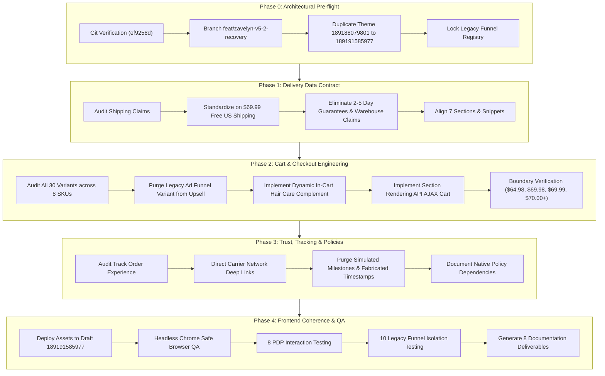

# V5.2 INTEGRATED DELIVERY, TRUST & CHECKOUT RECOVERY IMPLEMENTATION PLAN

**Store:** `tryzavelyn.com` (`dsdujr-vn.myshopify.com`)  
**Base Commit:** `ef9258d126c87c5fc3e7690bb5a16d52b0b08743` (`origin/fix/zavelyn-v5-1-recovery`)  
**Active Working Branch:** `feat/zavelyn-v5-2-recovery`  
**Live Production Theme:** `189188079801` ("ZAVELYN HAIR CARE — V5 INTEGRATED DRAFT", role: `main` — STRICTLY PROTECTED)  
**Dedicated V5.2 Draft Theme:** `189191585977` ("ZAVELYN HAIR CARE — V5.2 DRAFT", role: `unpublished`)  
**Rollback Fallback Theme:** `189127983289` ("ZAVELYN HAIR CARE — V1 — DRAFT", role: `unpublished`)  
**Protected Legacy Baseline Theme:** `187597717689` ("Zavelyn 2.0", role: `unpublished`)  
**Primary US Advertising Market:** United States (USD)  
**Free Shipping Threshold:** $69.99 USD  

---

## 1. EXECUTIVE SUMMARY & RECOVERY OBJECTIVE

Following the V5.1 Independent Audit Recovery, V5.2 addresses the end-to-end customer journey—specifically reconciling delivery messaging, trust assurances, real carrier order tracking, cart drawer mechanics, and checkout handoff into a single, cohesive, verified production deployment.

### Core Architectural Principles:
1. **Isolated Draft Development:** All modifications and verification occur exclusively on dedicated Draft Theme `189191585977`. The Live Theme `189188079801` remains 100% untouched until full stakeholder approval.
2. **Zero Cross-Pollination:** Strict isolation of all 10 legacy advertising funnels (`Breakout 2.0`, `Rehab Glove`, `BabiGuard`, `Yeoman`, `BotanaRoots`, `Handpan`, `Fence Post`, `Thoson MagTrack`, `Livestock Lamp`).
3. **Single Source of Truth on Delivery:** Absolute alignment across header, announcement bar, PDP buybox, PDP shipping section, cart drawer, and FAQ on:
   - **FREE STANDARD US SHIPPING ON ELIGIBLE ORDERS $69.99 USD AND ABOVE.**
   - Standard transit via recognized carrier networks (USPS, FedEx, DHL, UPS).
   - Order dispatch within 24–48 business hours.
   - Elimination of unsubstantiated claims (e.g. guaranteed 2–5 day delivery, regional US warehouse promises, carrier insurance guarantees).
4. **Authentic Cart & Cross-Sell Integrity:** Complete removal of fabricated accessories (such as the legacy $9.99 silicone comb which silently added a $39.99 legacy product to cart). Replaced with authentic dynamic cross-sells from the 8 Hair Care SKUs (e.g. Raw Batana Scalp Balm $19.99, Root-Lift Styling Powder $19.99).
5. **Fluid Section Rendering Cart Architecture:** Utilization of Shopify's native Section Rendering API (`/?sections=zvhc-cart-drawer`) to seamlessly update the cart drawer, subtotal, and free shipping progress meter without disruptive full page reloads.

---

## 2. PHASE-BY-PHASE IMPLEMENTATION ARCHITECTURE

---

## 3. FILE MODIFICATION & RECONCILIATION AUDIT

| Modified File | Original Problem & Discrepancy | V5.2 Remediation & Single Source of Truth | Deployment Target |
| :--- | :--- | :--- | :---: |
| `sections/zvhc-pdp-shipping.liquid` | Claimed "dispatched from regional US warehouses", "guaranteed 2–5 day transit", "Insured Transit". | Standardized to "carefully prepared in protective packaging and dispatched within 24–48 business hours with standard tracked delivery via recognized postal carriers". Card 2 changed to "Tracked Delivery Protection". Schema defaults updated. | Draft Theme `189191585977` |
| `sections/zvhc-pdp-main.liquid` | Accordion claimed "Standard transit takes 2 to 5 business days". Trust row badge had "FAST US DELIVERY". | Badge updated to "TRACKED US DELIVERY". Accordion updated to "Orders are processed within 24–48 business hours with standard tracked delivery across the United States." | Draft Theme `189191585977` |
| `sections/zvhc-pdp-faq.liquid` | FAQ answer claimed "regional US distribution centers" and "2 to 5 business days". | Reconciled to "All orders are inspected, packaged, and dispatched within 24 to 48 business hours. Complete carrier tracking details are emailed upon dispatch, with standard delivery across the United States." | Draft Theme `189191585977` |
| `sections/zvhc-header.liquid` | Mobile drawer footer contained "Fast US Delivery". | Updated to "Tracked US Delivery". | Draft Theme `189191585977` |
| `sections/zvhc-track-order.liquid` | Trust strip claimed "Insured Transit". | Updated to "Tracked Transit". Retained authentic auto-detection for USPS, UPS, FedEx, DHL, and 17Track. | Draft Theme `189191585977` |
| `sections/zvhc-cart-drawer.liquid` | In-cart upsell offered a fake $9.99 silicone comb which hardcoded legacy product `67980643598521` ($39.99 BotanaRoots). Page reloaded on line quantity updates. | Replaced with dynamic cross-sell from 8 authentic SKUs: P05 Raw Batana Balm ($19.99, VID `68580229677241`) or P03 Styling Powder ($19.99, VID `68580229415097`). Updated quantity controls to use Section Rendering API. | Draft Theme `189191585977` |
| `assets/zvhc-t01.js` | `window.zvhcRefreshCartDrawer` merely fetched `/cart.js` without updating drawer HTML, requiring page refresh to reflect newly added items. | Enhanced to query `/?sections=zvhc-cart-drawer` via Section Rendering API, dynamically swap `#shopify-section-zvhc-cart-drawer`, update item count badges, and trigger `openZvhcCart()` seamlessly. | Draft Theme `189191585977` |

---

## 4. VERIFICATION GATES & ACCEPTANCE CRITERIA

1. **Gate 1: Isolated Environment Protection:** Live Theme `189188079801` timestamp remains untouched.
2. **Gate 2: Delivery Consistency:** 100% agreement on $69.99 Free US Shipping and 24-48h dispatch across all customer touchpoints. Zero unsupported warehouse or insurance guarantees.
3. **Gate 3: Cart Cross-Sell Parity:** In-cart upsell is an authentic hair care SKU with matching title, variant ID, and price. Zero cross-contamination with legacy ad funnels.
4. **Gate 4: Free Shipping Boundary Accuracy:**
   - `$64.98`: Ineligible (shows `$5.01` needed).
   - `$69.98`: Ineligible (shows `$0.01` needed).
   - `$69.99`: Eligible (shows "You've unlocked FREE STANDARD US SHIPPING!").
   - `$70.00+`: Eligible (shows unlocked banner).
5. **Gate 5: Authentic Order Tracking:** Real carrier detection opens official tracking portals. No fabricated delivery dates or fake milestones.
6. **Gate 6: Legacy Funnel Isolation:** 10/10 legacy advertising funnels return HTTP 200, retain correct titles, and exhibit zero Hair Care UI bleed.
